# UX 2: Phân tích và xác định

> Giai đoạn 2 của quy trình UX. Viết ngày 2026-09-27. Đầu vào: persona và phát hiện ở `01-discovery.md`, nghiệp vụ ở `business-flow.md`, trạng thái và quyền ở `packages/shared-types`.
> Sơ đồ viết bằng Mermaid; GitHub và VS Code (với extension Mermaid) hiển thị trực tiếp.

## 1. Hành trình người dùng (User Journey Map)

Điểm cảm xúc từ 1 (bực) tới 5 (hài lòng) là **giả định** theo persona, cần kiểm chứng ở giai đoạn 5.

### 1.1 Chuyên viên tuyển dụng (P1): từ yêu cầu đã duyệt tới nhận việc

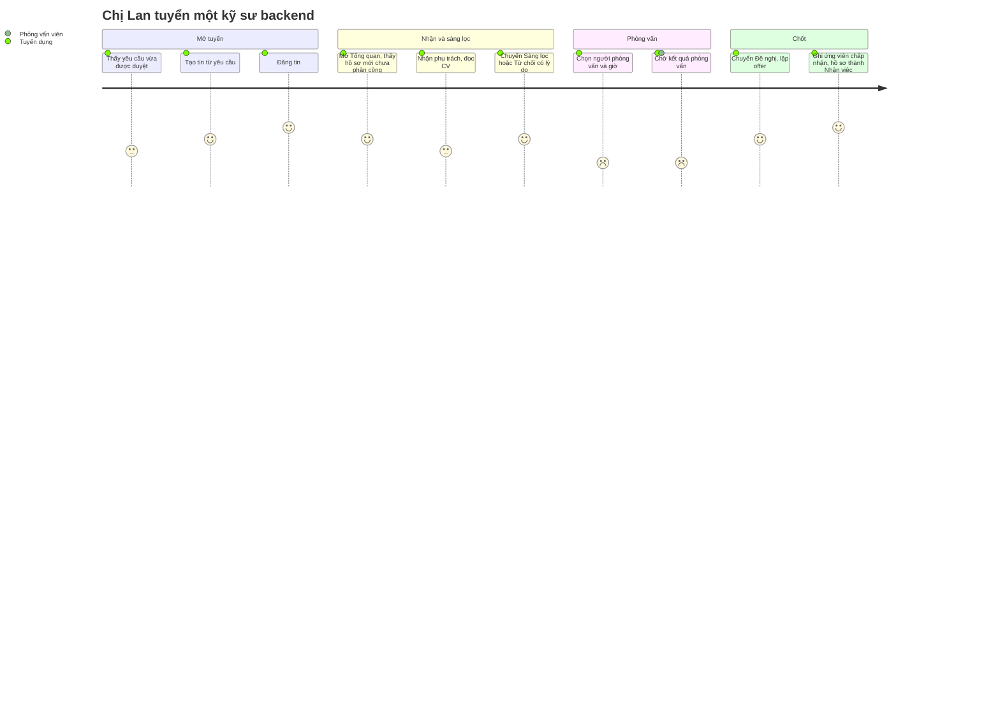

| Bước        | Hành động                               | Màn hình                                  | Suy nghĩ                                        | Cảm xúc | Cơ hội thiết kế                                                                      |
| ----------- | --------------------------------------- | ----------------------------------------- | ----------------------------------------------- | ------- | ------------------------------------------------------------------------------------ |
| Mở tuyển    | Tạo tin từ yêu cầu đã duyệt, đăng tin   | Chi tiết yêu cầu → Tạo tin → Chi tiết tin | "Không muốn gõ lại phòng ban, vị trí, số lượng" | 4       | Nút "Tạo tin" trên yêu cầu đã duyệt điền sẵn dữ liệu; báo số lượng còn lại được phép |
| Nhận hồ sơ  | Xem hồ sơ mới, nhận phụ trách           | Tổng quan → Hồ sơ (lọc Mới)               | "Có hồ sơ nào đang bị bỏ quên không?"           | 4       | Việc cần xử lý dẫn thẳng tới danh sách đã lọc                                        |
| Sàng lọc    | Đọc CV, chuyển bậc hoặc từ chối         | Chi tiết hồ sơ                            | "Chỉ muốn thấy những nút hợp lệ"                | 3       | Nút theo `APPLICATION_TRANSITIONS`; từ chối mở dialog bắt buộc lý do                 |
| Xếp lịch    | Chọn người phỏng vấn, giờ, vòng         | Dialog đặt lịch                           | "Người này có rảnh không?"                      | 2       | Báo trùng lịch 60 phút ngay trong dialog (409 hiện inline), không đóng form          |
| Chờ kết quả | Theo dõi lịch chưa có kết quả           | Lịch phỏng vấn                            | "Phải nhắn hỏi lại"                             | 2       | Lọc "Chờ kết quả"; cột người phỏng vấn; (ngoài phạm vi: nhắc qua email)              |
| Chốt        | Chuyển Đề nghị, lập offer, ghi phản hồi | Chi tiết hồ sơ, tab Offer                 | "Sao chưa chuyển được Đề nghị?"                 | 4       | Nút Đề nghị bị khóa kèm lý do khi chưa có vòng Đạt hoặc còn lịch chờ kết quả         |

**Điểm đau lớn nhất:** xếp lịch và chờ kết quả phỏng vấn (điểm 2), khớp với số liệu ở `01-discovery.md` mục 2.1.

### 1.2 Ứng viên (P6): từ thấy tin tới chờ liên hệ

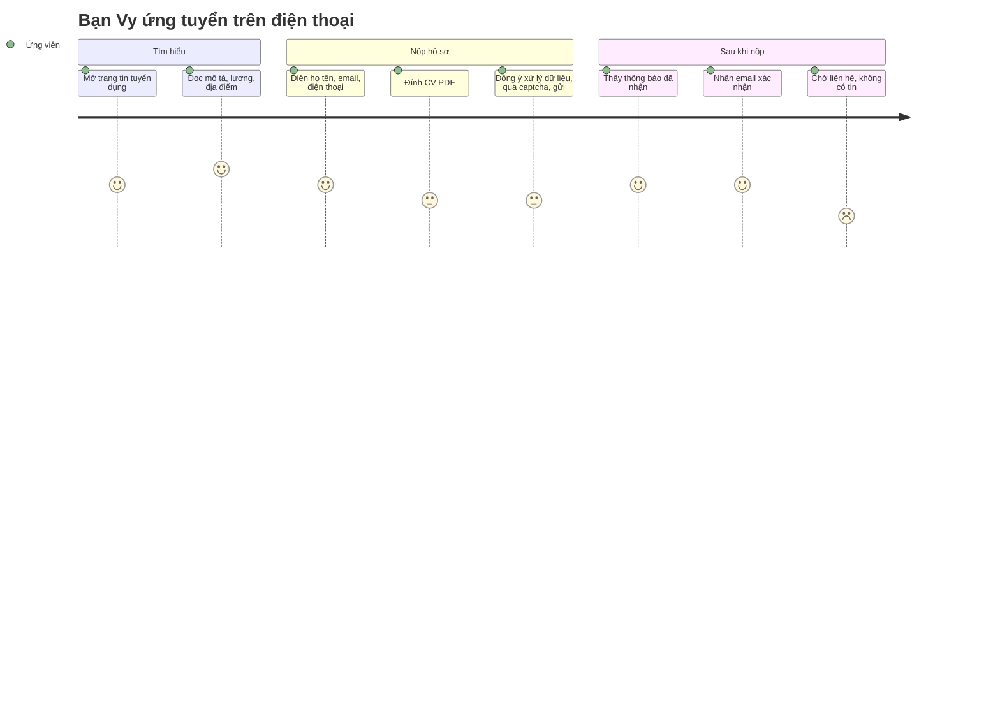

| Bước        | Hành động              | Điểm chạm             | Suy nghĩ                      | Cảm xúc | Cơ hội thiết kế                                                                                                                |
| ----------- | ---------------------- | --------------------- | ----------------------------- | ------- | ------------------------------------------------------------------------------------------------------------------------------ |
| Tìm hiểu    | Đọc tin                | Trang tin công khai   | "Lương bao nhiêu, làm ở đâu?" | 5       | Lương, địa điểm, phòng ban ở đầu trang                                                                                         |
| Đính CV     | Chọn tệp từ điện thoại | Form công khai        | "File DOC có được không?"     | 3       | Ghi rõ "PDF hoặc DOCX, tối đa 5 MB" trước khi chọn; báo lỗi 400 và 413 ngay ở ô tệp                                            |
| Gửi         | Captcha, gửi           | Form                  | "Đã gửi được chưa?"           | 3       | Nút gửi khóa lại khi đang gửi; 429 báo thời gian chờ                                                                           |
| Sau khi nộp | Đọc thông báo và email | Trang cảm ơn, hộp thư | "Nhận rồi, giờ chờ"           | 4       | Nội dung cố định (không lộ đã nộp trùng hay chưa); nói rõ bước tiếp theo                                                       |
| Chờ         | Không có tin           | Không có              | "Chắc bị loại rồi"            | 2       | Trang cảm ơn và email nói rõ bước tiếp theo và thời gian dự kiến (quyết định C); email cập nhật trạng thái là hướng phát triển |

Tại Việt Nam nhà tuyển dụng thường liên hệ ứng viên trực tiếp qua điện thoại hoặc Zalo, nên số điện thoại là trường bắt buộc của form và trang cảm ơn nên nhắc ứng viên để ý cuộc gọi từ công ty.

### 1.3 Trưởng bộ phận (P2): vòng đời yêu cầu tuyển dụng

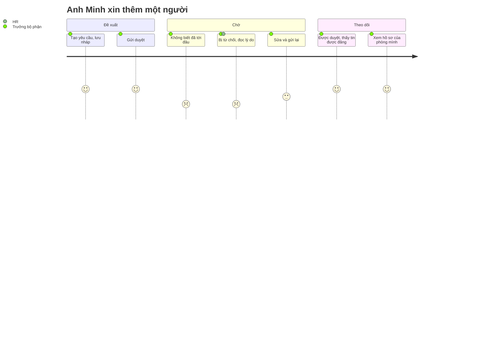

**Cơ hội thiết kế:** timeline trên chi tiết yêu cầu; lý do từ chối hiện nổi bật ngay đầu trang; Tổng quan của vai trò này cần hai việc "yêu cầu bị từ chối cần sửa" và "yêu cầu nháp chưa gửi" (quyết định D ở mục 4).

## 2. Luồng người dùng (User Flow)

Mỗi luồng khớp đúng máy trạng thái trong `shared-types` và quy tắc ở `business-flow.md`. Hình thoi là điều kiện hệ thống kiểm; hình chữ nhật bo góc là màn hình hoặc dialog.

### 2.1 Đăng nhập và trang đích theo vai trò

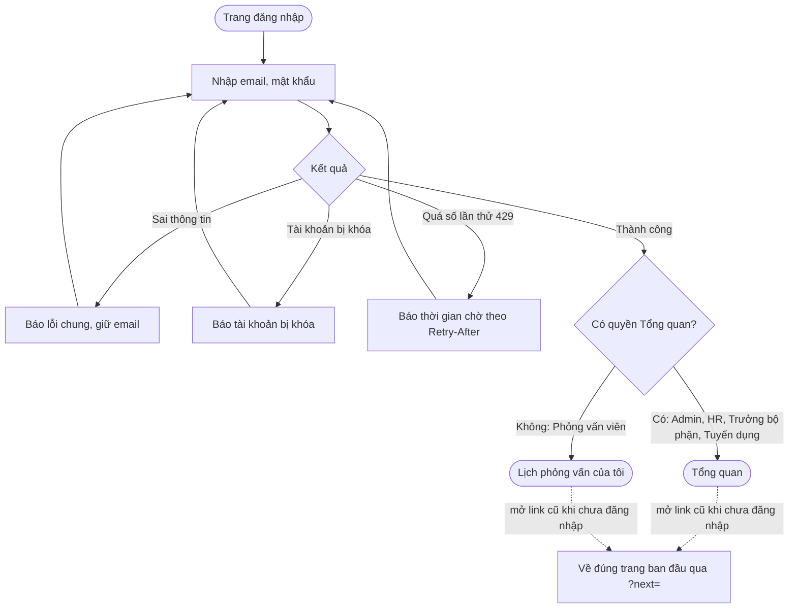

### 2.2 Yêu cầu tuyển dụng

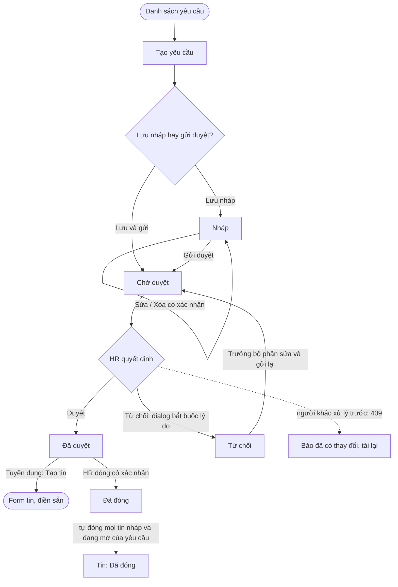

### 2.3 Tin tuyển dụng

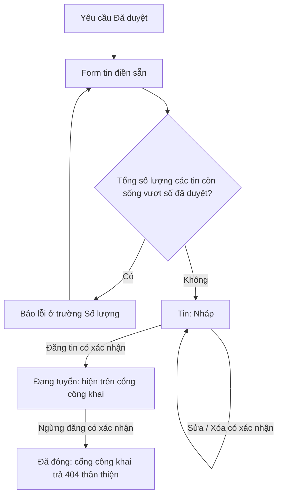

### 2.4 Hồ sơ ứng tuyển

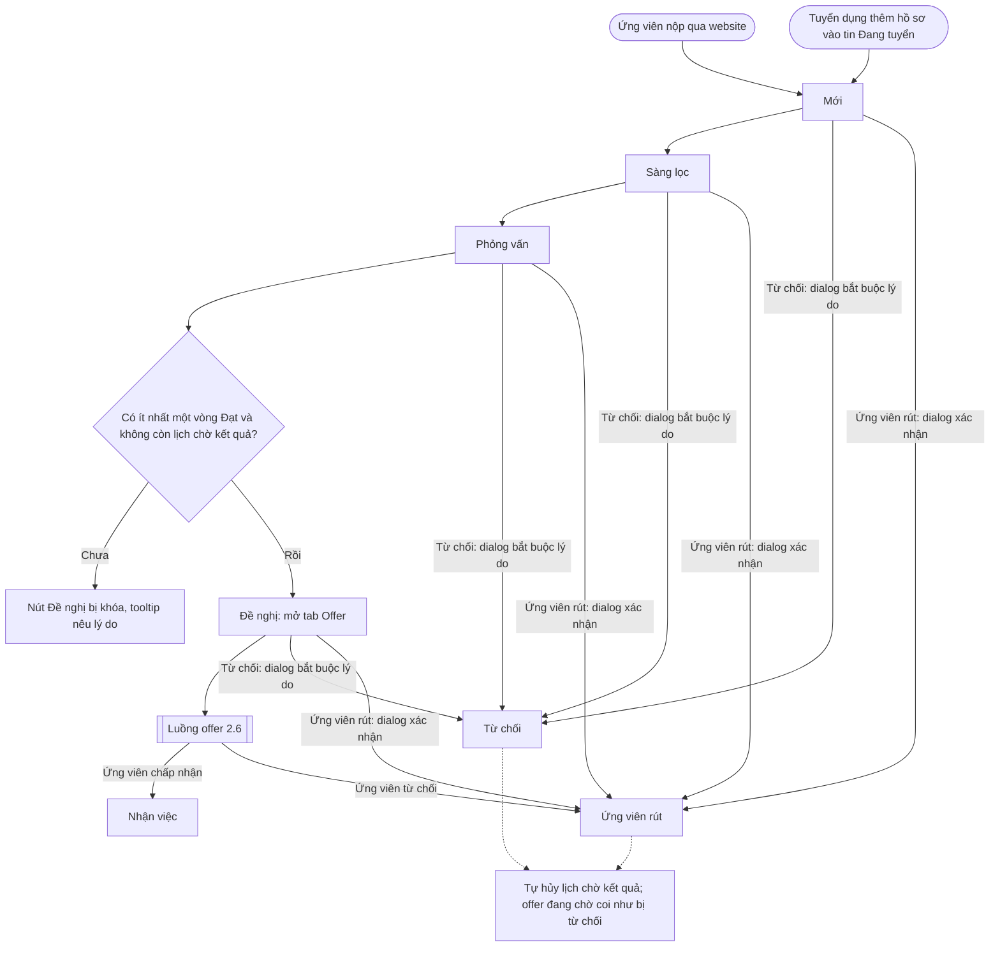

Không nhảy bậc, không quay lại: màn chi tiết chỉ hiện các nút có trong `APPLICATION_TRANSITIONS[status]`. Nhận việc không có nút riêng, chỉ đến qua offer.

Quy tắc này được giữ (quyết định A): phễu ở Tổng quan tính "từng đạt bậc đó", nên bỏ qua bậc làm sai số liệu. Với ứng viên được giới thiệu không cần sàng lọc, người dùng bấm thêm một lần "Chuyển sang Sàng lọc" rồi "Chuyển sang Phỏng vấn"; ghi chú của bước chuyển có thể ghi "Giám đốc giới thiệu". Đường tắt một nút là hướng phát triển.

### 2.5 Lịch phỏng vấn

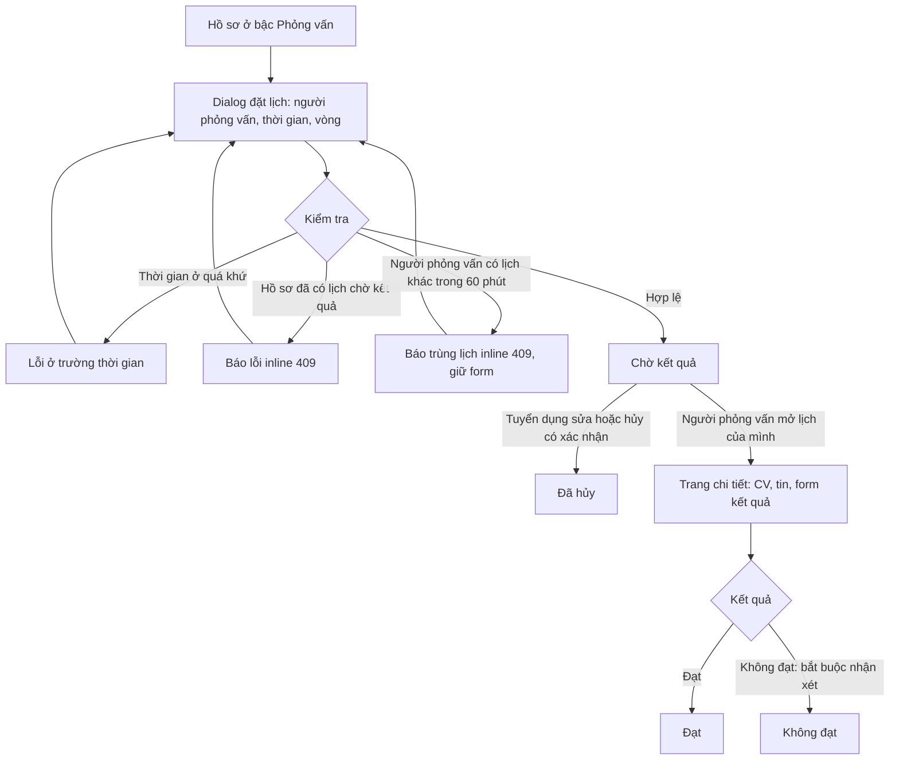

**Trên điện thoại** (người phỏng vấn thường mở ngay trước buổi phỏng vấn), trang chi tiết lịch không xếp mọi thứ thành một cột dài. Dùng ba tab theo thứ tự: **Kết quả** (mặc định, nút Đạt/Không đạt và ô nhận xét), **CV** (nút mở tệp ở tab mới, không nhúng trình xem PDF), **Tin tuyển dụng** (mô tả rút gọn, có nút xem đầy đủ). Nút Đạt và Không đạt đặt cách xa nhau và Không đạt luôn mở ô nhận xét bắt buộc để tránh bấm nhầm.

### 2.6 Offer

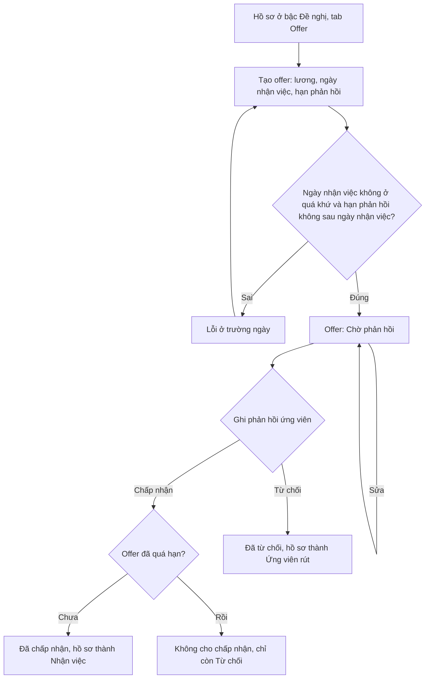

### 2.7 Ứng viên nộp hồ sơ qua cổng công khai

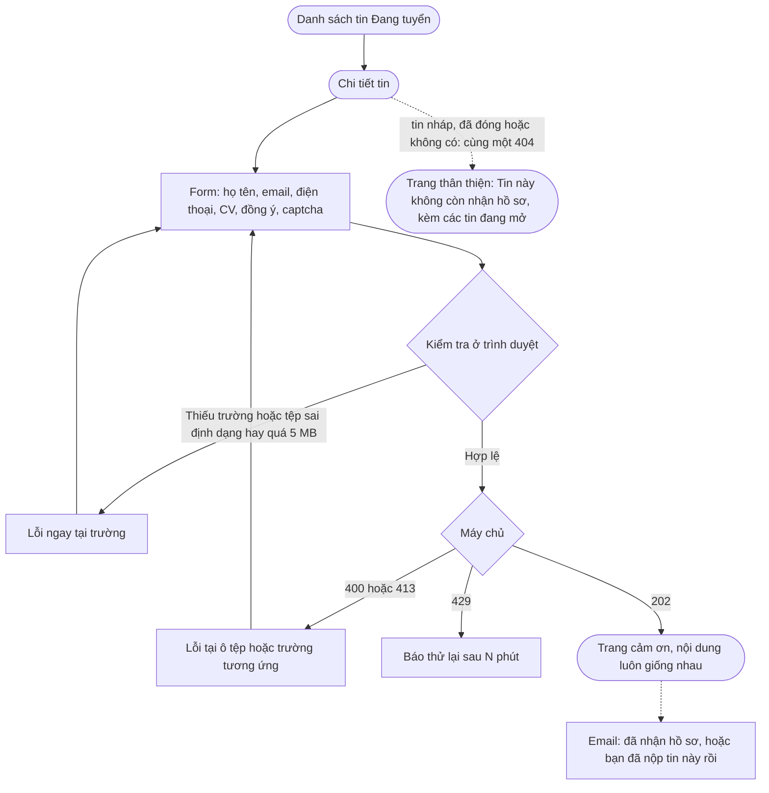

Mã 202 cố định là chủ ý và không đổi: máy chủ kiểm tra nội dung CV và lưu tệp **trước khi** trả lời, nên tệp hỏng vẫn trả 400 ngay tại ô tệp; còn nộp mới, nộp trùng và email đã có đều trả cùng một nội dung để người ngoài không dò được ai đã ứng tuyển. Tin đã đóng trả 404 theo hướng dẫn của Google cho tin hết hạn; phần trải nghiệm được giữ bằng trang 404 thân thiện (không phân biệt tin đã đóng với tin không tồn tại, để không lộ thông tin).

**Nội dung trang cảm ơn** (quyết định C): xác nhận đã nhận hồ sơ, nêu thời gian phản hồi dự kiến do công ty đặt, nhắc để ý cuộc gọi hoặc email từ công ty. Email xác nhận lặp lại các ý này.

## 3. Cấu trúc thông tin (IA)

### 3.1 Sơ đồ trang (Sitemap)

Đường dẫn web là **đề xuất**, khớp với `href` mà API Tổng quan đang trả (`/requisitions`, `/applications`, `/interviews`).

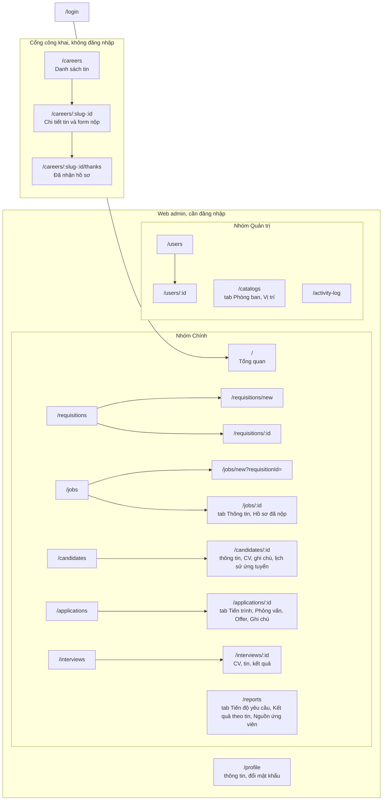

Tạo và sửa ứng viên, hồ sơ, lịch phỏng vấn, người dùng, danh mục là **dialog** trên trang danh sách hoặc chi tiết. Yêu cầu và tin có form toàn trang vì dài và có trình soạn thảo mô tả.

### 3.2 Ma trận vai trò × màn hình

Suy ra từ `ROLE_PERMISSIONS`. Menu ẩn mục mà vai trò không vào được (design guide).

| Màn hình           | Admin        | HR                               | Trưởng bộ phận                       | Tuyển dụng                 | Phỏng vấn viên                |
| ------------------ | ------------ | -------------------------------- | ------------------------------------ | -------------------------- | ----------------------------- |
| Tổng quan          | Toàn công ty | Toàn công ty                     | Phòng mình                           | Toàn công ty               | Không                         |
| Yêu cầu tuyển dụng | Toàn quyền   | Xem, duyệt, từ chối, đóng        | Tạo, sửa, gửi, xóa nháp (phòng mình) | Xem                        | Không                         |
| Tin tuyển dụng     | Toàn quyền   | Xem                              | Xem (phòng mình)                     | Tạo, sửa, đăng, ngừng, xóa | Không                         |
| Ứng viên           | Toàn quyền   | Xem                              | **Không**                            | Toàn quyền, CV, ghi chú    | Xem (ứng viên mình phỏng vấn) |
| Hồ sơ ứng tuyển    | Toàn quyền   | Xem, không thấy Offer            | Xem (phòng mình)                     | Toàn quyền, Offer          | Xem (hồ sơ mình phỏng vấn)    |
| Lịch phỏng vấn     | Toàn quyền   | Xem; lịch mình: nhập kết quả (*) | Lịch mình: xem, nhập kết quả (*)     | Đặt, sửa, hủy              | Xem lịch mình, nhập kết quả   |
| Báo cáo            | Xem, xuất    | Xem, xuất                        | Không                                | Không                      | Không                         |
| Người dùng         | Toàn quyền   | Quản lý (trừ tài khoản Admin)    | Không                                | Không (B6 sẽ cho xem)      | Không                         |
| Danh mục           | Toàn quyền   | Chỉ lấy dữ liệu cho ô chọn       | Chỉ lấy dữ liệu cho ô chọn           | Chỉ lấy dữ liệu cho ô chọn | Không                         |
| Nhật ký hoạt động  | Xem, xuất    | Không                            | Không                                | Không                      | Không                         |
| Hồ sơ cá nhân      | Có           | Có                               | Có                                   | Có                         | Có                            |

Menu của mỗi vai trò:

- **Admin:** Chính (7 mục) và Quản trị (3 mục).
- **HR:** Tổng quan, Yêu cầu, Tin, Ứng viên, Hồ sơ, Lịch phỏng vấn, Báo cáo, Người dùng.
- **Trưởng bộ phận:** Tổng quan, Yêu cầu, Tin, Hồ sơ.
- **Tuyển dụng:** Tổng quan, Yêu cầu, Tin, Ứng viên, Hồ sơ, Lịch phỏng vấn.
- **Phỏng vấn viên:** Lịch phỏng vấn, Hồ sơ, Ứng viên.

(*) Quyền mới theo quyết định B, **chưa cài đặt**; hiện chỉ Phỏng vấn viên và Admin nhập được kết quả. Khi cài, Lịch phỏng vấn sẽ xuất hiện trong menu của Trưởng bộ phận.

Danh mục chỉ hiện trong menu của Admin (quyết định E); các vai trò khác dùng dữ liệu này ngầm trong các ô chọn phòng ban và vị trí.

### 3.3 Nguyên tắc tổ chức nội dung

- **Theo đối tượng, không theo vai trò:** mỗi đối tượng nghiệp vụ có một danh sách và một trang chi tiết dùng chung. Vai trò chỉ quyết định thấy dòng nào và nút nào.
- **Đi theo chuỗi nghiệp vụ:** trang chi tiết liên kết sang bước trước và sau (yêu cầu → các tin → hồ sơ → lịch phỏng vấn → offer), để người dùng không phải quay về menu.
- **Tổng quan là hộp việc:** mỗi việc cần xử lý dẫn tới danh sách đã lọc sẵn.
- **Ngoài phạm vi thì 404, thiếu quyền thì 403:** bản ghi của phòng ban khác (ví dụ Trưởng bộ phận mở hồ sơ của phòng khác) hiện trang "không tồn tại". Màn mà vai trò không có quyền (ví dụ Trưởng bộ phận gõ `/candidates`) hiện `ForbiddenState`. Trên chi tiết hồ sơ, tên ứng viên của Trưởng bộ phận là chữ thường, không có liên kết sang `/candidates/:id`.

## 4. Quyết định thiết kế (2026-10-02)

Các quyết định dưới đây do người thực hiện tự chốt theo hướng hợp lý nhất cho đồ án, sau khi đối chiếu với code. Chúng đã ghi vào `business-flow.md` mục 7 (mục 10 đến 19, trạng thái "đã chốt, chưa cài"). **Chưa có thay đổi nào ở backend.** Phần cần sửa backend là việc riêng ở mục 5.

| #   | Vấn đề                                                                | Quyết định                                                                                                                                                | Lý do                                                                                                                                             |
| --- | --------------------------------------------------------------------- | --------------------------------------------------------------------------------------------------------------------------------------------------------- | ------------------------------------------------------------------------------------------------------------------------------------------------- |
| A   | Bỏ qua bậc Sàng lọc cho ứng viên được giới thiệu                      | **Giữ không nhảy bậc.** Người dùng bấm thêm một lần; đường tắt là hướng phát triển                                                                        | Phễu tính "từng đạt bậc đó", nhảy bậc làm sai số liệu; chi phí chỉ một lần bấm                                                                    |
| B   | Trưởng bộ phận và HR là người phỏng vấn nhưng không nhập được kết quả | **Cấp `interview.list.view` (Trưởng bộ phận) và `interview.result.record` (Trưởng bộ phận, HR), nhưng chỉ nhập được kết quả cho lịch xếp cho chính mình** | Khớp thực tế trưởng phòng hay phỏng vấn; không phải đổi schema như cơ chế nhiều vai trò; quy tắc "chỉ lịch của mình" đã có sẵn cho Phỏng vấn viên |
| C   | Ứng viên bị "im lặng" sau khi nộp                                     | **Chỉ sửa nội dung trang cảm ơn và email xác nhận** (bước tiếp theo, thời gian dự kiến, nhắc để ý điện thoại). Email từ chối tự động là hướng phát triển  | Không đổi backend; phù hợp thực tế Việt Nam liên hệ qua điện thoại hoặc Zalo                                                                      |
| D   | Tổng quan của Trưởng bộ phận luôn trống                               | **Thêm hai việc: "Yêu cầu bị từ chối cần sửa" và "Yêu cầu nháp chưa gửi"**                                                                                | Nếu không, trang đầu tiên của vai trò này vô giá trị                                                                                              |
| E   | Danh mục trong menu                                                   | **Chỉ Admin thấy mục Danh mục.** Vai trò khác dùng dữ liệu ngầm trong ô chọn                                                                              | Tránh rác menu; quyền đọc API giữ nguyên                                                                                                          |
| F   | Đường dẫn cổng công khai                                              | **`/careers` và `/careers/<slug>-<id>`**, ví dụ `/careers/lap-trinh-vien-backend-3f2a`. Web tách id ở cuối; slug sai hoặc cũ thì chuyển về slug đúng      | Dễ đọc và thân thiện với công cụ tìm kiếm mà không đổi API hay thêm cột                                                                           |
| G   | Trang đích sau đăng nhập của Phỏng vấn viên                           | **`/interviews`, lọc sẵn "Chờ kết quả"**                                                                                                                  | Vai trò không có Tổng quan                                                                                                                        |
| H   | Trưởng bộ phận trên chi tiết hồ sơ                                    | **Hiện tên, email, điện thoại và liên kết CV; tên không có liên kết sang `/candidates/:id`**                                                              | Cần xem CV để đánh giá; trang ứng viên có thể chứa lịch sử ứng tuyển ở phòng ban khác (API đã chặn bằng 403)                                      |
| I   | CV hiện trên chi tiết hồ sơ                                           | **Nếu hồ sơ không có CV riêng thì dùng CV của ứng viên**                                                                                                  | Hiện `GET /applications/:id/cv` chỉ trả CV nộp qua website nên hồ sơ do Tuyển dụng nhập sẽ thiếu CV với Trưởng bộ phận                            |
| J   | Trải nghiệm tin đã đóng                                               | **Giữ 404**, nhưng trang 404 thân thiện, gợi ý tin đang mở                                                                                                | Google cho phép 404 hoặc 410 với tin hết hạn; giữ quy tắc không lộ tin nháp hay không tồn tại                                                     |
| K   | Mã 202 của form nộp hồ sơ                                             | **Giữ nguyên**                                                                                                                                            | CV đã được kiểm tra đồng bộ trước khi trả lời; 202 cố định để không dò được email                                                                 |

## 5. Việc cần sửa backend để khớp tài liệu

Chưa làm, mỗi việc một commit riêng khi bắt đầu. Mỗi việc đi qua `/tl-review plan` và cập nhật `rbac-matrix`.

1. **Quyết định B:** thêm `interview.list.view` cho DEPT_MANAGER và `interview.result.record` cho DEPT_MANAGER và HR_MANAGER trong `packages/shared-types`; `InterviewsService.scopedQuery` và `findScoped` giới hạn theo `interviewerId` cho cả hai vai trò khi họ không có quyền đặt lịch (HR đang xem mọi lịch, cần xác nhận phạm vi này trước khi sửa); e2e: người phỏng vấn là Trưởng bộ phận nhập được kết quả, nhập lịch của người khác nhận 404.
2. **Quyết định D:** thêm hai loại việc vào `DashboardService.todoFor` (cần quyền `requisition.create` hoặc `requisition.submit`, đếm theo phòng ban của người gọi).
3. **Quyết định I:** `ApplicationsService.downloadCv` và `hasCv` rơi về CV của ứng viên khi hồ sơ không có CV riêng.
4. **Danh sách chức năng:** sửa mục 1.1.2.1 thành "chuyển tới trang đích theo vai trò".

Các việc còn lại (A, C, E, F, G, H, J, K) chỉ ảnh hưởng giao diện web, không đụng backend.
